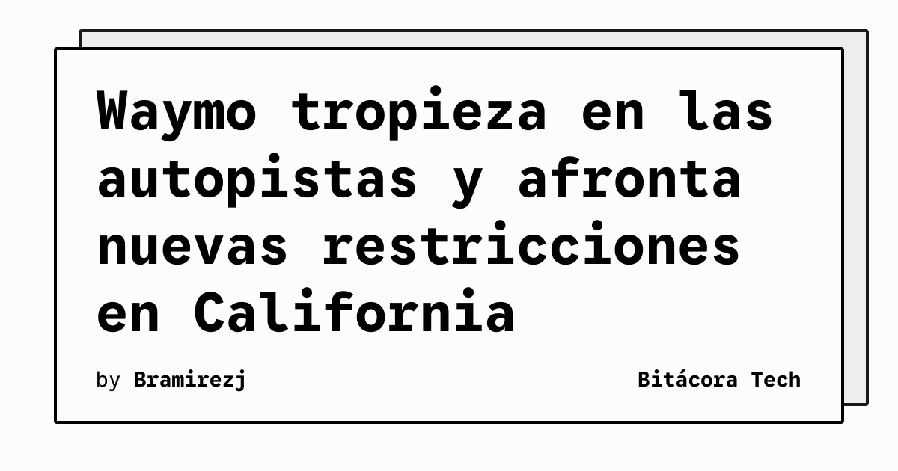

La conducción autónoma de Waymo ha ganado presencia en las calles urbanas, pero los escenarios de autopista siguen exponiendo límites operativos. The Verge documentó un incidente ocurrido el 6 de noviembre en la Interestatal 280, cuando un robotaxi intentó adelantar a dos vehículos de la Patrulla de Carreteras de California durante una maniobra de control del tráfico.

El episodio se suma a otros problemas registrados en autopistas y zonas de obras. La empresa comunicó once incidentes entre octubre y noviembre de 2026 relacionados con áreas de construcción. Según el reporte, el Departamento de Vehículos Motorizados de California prohibió la circulación de los vehículos de Waymo en las autopistas estatales la semana previa a la publicación.

## Qué implica

Para los equipos que desarrollan sistemas autónomos, una autopista no es solo una versión rápida de una calle urbana. Las maniobras temporales, los vehículos de emergencia y los cambios de carril durante una intervención exigen interpretar señales incompletas y comportamientos humanos poco previsibles.

La restricción también afecta la escala del servicio. Una flota puede funcionar correctamente en rutas conocidas y, aun así, necesitar límites geográficos cuando cambia el contexto operacional. Ese límite debe comunicarse de forma clara al pasajero antes de iniciar el viaje. Ese tipo de delimitación reduce el riesgo, pero convierte la cobertura real en una propiedad que depende tanto de la regulación como del rendimiento del modelo.

## Hechos confirmados

- Un robotaxi de Waymo intentó adelantar a dos patrullas durante una interrupción de tráfico en la Interestatal 280 el 6 de noviembre.
- El Departamento de Vehículos Motorizados de California prohibió los vehículos de Waymo en las autopistas estatales, según el reporte.
- Waymo comunicó once incidentes en zonas de obras entre octubre y noviembre de 2026.

## Análisis

El caso sugiere que la validación de un sistema autónomo debe ponderar más que la conducción cotidiana. La gestión de excepciones, la interacción con autoridades y la respuesta ante obras temporales son componentes centrales de seguridad. Para el sector, la métrica relevante no será solo cuántos kilómetros puede recorrer un vehículo, sino en cuántos contextos ambiguos puede detenerse o pedir intervención sin crear un nuevo riesgo.

**Fuente:** [The Verge](https://www.theverge.com/transportation/1042151/waymo-highway-ban-ai-safety-recalls).
