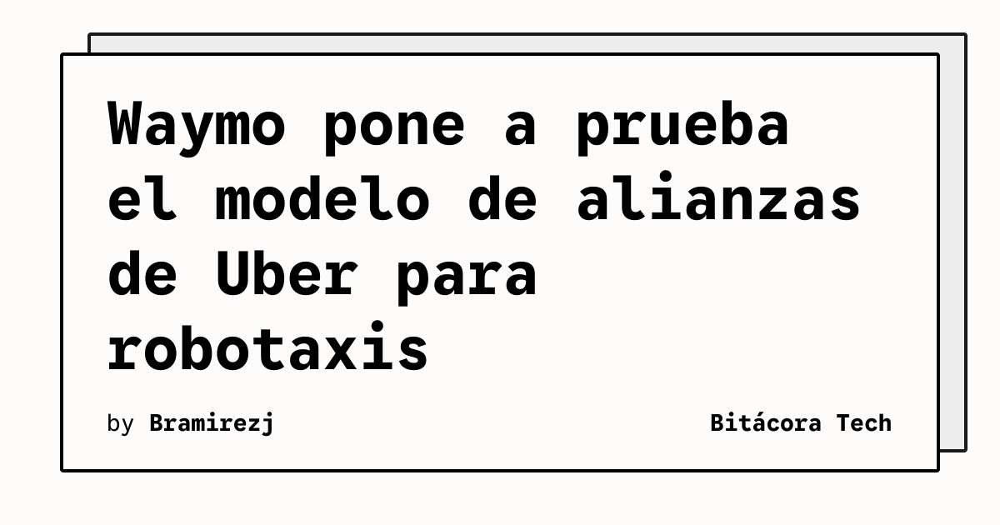

Las alianzas entre plataformas de transporte y operadores autónomos parecían una vía eficiente para llevar los robotaxis a más ciudades. Sin embargo, la relación entre Uber y Waymo se ha mostrado más frágil de lo que sugerían los mensajes públicos de la compañía, según el análisis de The Verge. La noticia llega mientras también cambia la relación de Uber con otras empresas de robótica.

## Qué implica

Un servicio autónomo no depende únicamente de que un vehículo pueda circular sin conductor. También necesita una plataforma de reservas, disponibilidad local, mantenimiento, permisos, atención al cliente y una economía que funcione en cada mercado. Si una de las partes cambia de estrategia, la red completa debe adaptarse.

Para Uber, asociarse permite ampliar la oferta sin desarrollar toda la tecnología de conducción autónoma. Para Waymo, la plataforma aporta demanda y una interfaz conocida por los usuarios. Esa complementariedad tiene un límite: cuando ambos actores quieren controlar más partes de la operación, los incentivos dejan de coincidir.

## Hechos confirmados

- Uber y Waymo habían trabajado juntos durante años en varias ciudades.
- El CEO de Uber había descrito la alianza como muy sólida durante una llamada de resultados de agosto.
- The Verge informa que la asociación resultó más frágil de lo que esa declaración sugería.
- El artículo también aborda el distanciamiento de Uber respecto de Serve Robotics.

## Análisis

La expansión de los robotaxis probablemente dependerá menos de un acuerdo aislado y más de la capacidad de cada compañía para operar una cadena completa. Las plataformas pueden ganar velocidad mediante alianzas, pero también adquieren dependencia estratégica. La señal para los equipos de producto es clara: los contratos deben contemplar cómo se reparten los datos, la experiencia del usuario y la continuidad del servicio cuando una asociación deja de ser prioritaria.

**Fuente:** [The Verge](https://www.theverge.com/transportation/1037667/waymo-serve-robotics-ditch-uber-autonomous-partnerships).
