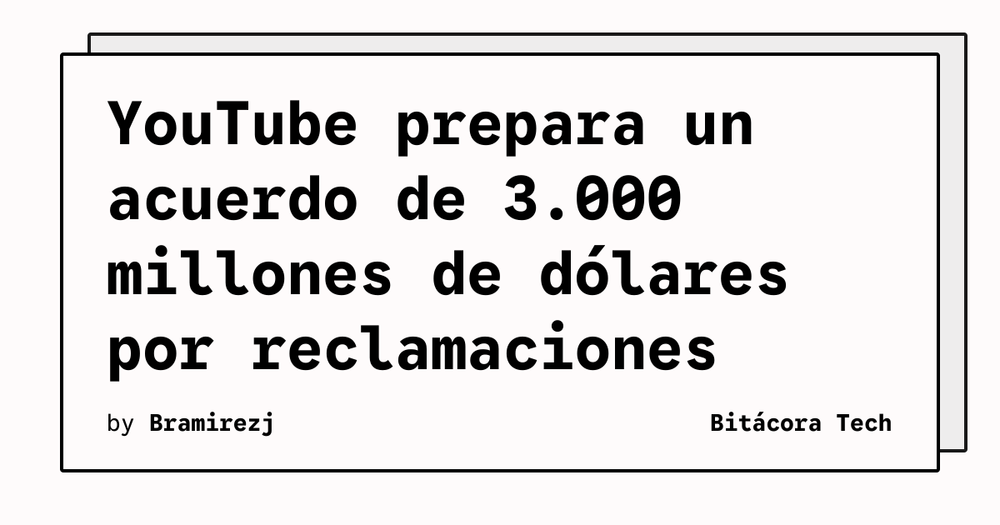

YouTube prepara un pago de 3.000 millones de dólares para miles de distritos escolares como parte de un acuerdo sobre reclamaciones de que su diseño adictivo perjudicó a menores, según la información recogida por The Verge a partir de Bloomberg. Las fuentes citadas describen el acuerdo como un pacto «en principio», no como una resolución final ya ejecutada.

El posible acuerdo incluiría nuevas medidas de protección para adolescentes. Las demandas forman parte de un litigio multidistrital en Estados Unidos que también involucra a Meta, Snap y TikTok. Los distritos escolares sostienen que las plataformas dañaron la salud mental de usuarios adolescentes.

The Verge recuerda que el primer juicio de referencia estaba previsto en Kentucky, pero las cuatro empresas alcanzaron antes un acuerdo conjunto de 27 millones de dólares. El siguiente juicio está previsto para febrero de 2027 en Oakland, California, con Meta, Snap y TikTok como demandadas. Google no respondió de inmediato a la solicitud de comentarios mencionada por el medio.

## Qué implica

La noticia conecta el diseño de productos digitales con riesgos legales y obligaciones de protección de menores. Para los equipos de producto, las medidas de seguridad dejan de ser únicamente una cuestión de configuración voluntaria: pueden convertirse en parte de una negociación, un compromiso público o una condición para resolver litigios.

El caso también muestra la importancia de distinguir entre un acuerdo anunciado y uno formalizado. El monto de 3.000 millones de dólares y las salvaguardas descritas proceden de reportes sobre una negociación. Hasta que se publiquen sus términos definitivos, no deben tratarse como obligaciones cerradas.

## Hechos confirmados

- YouTube estaría preparando un acuerdo de 3.000 millones de dólares con miles de distritos escolares.
- Las reclamaciones sostienen que el diseño de la plataforma perjudicó a menores.
- El acuerdo incluiría nuevas salvaguardas para adolescentes.
- Las fuentes describen el pacto como alcanzado «en principio» y Google no había respondido de inmediato a The Verge.

## Análisis

Si se formaliza, el acuerdo podría elevar el coste de no demostrar cómo se identifican y reducen los riesgos de diseño para menores. También podría reforzar la presión sobre otras plataformas para documentar sus controles. Esa es una posible lectura de impacto, no una conclusión jurídica sobre el litigio.

**Fuente:** [The Verge](https://www.theverge.com/streaming/1039096/youtube-social-media-addiction-school-districts-settlement).
